  
  
  
  

---

### 🇬🇧 About Me

Full-stack developer **and** systems/network specialist based in **Istanbul**. My core is backend development with **ASP.NET (C#)** and **PHP (Laravel)**, paired with modern frontends in **Next.js & React**. On the infrastructure side I manage **MikroTik & Ubiquiti UniFi** networks, **HP servers** (iLO, RAID, backups) and **QEMU** virtual machines, so I own projects end to end: I don't just build them, I keep them running.

- 🚀 Currently working as a **Freelance Developer** with [ON4 (ondört)](https://ondort.co)
- 🧠 SQL query optimization, OOP design, MS SQL · MySQL · SQLite
- 🐍 Python for data analysis & automation · Bash scripts on Linux
- 🤖 Currently leveling up in **Machine Learning**
- 📫 Open to **remote** or **Istanbul** roles

### 🇹🇷 Hakkımda

İstanbul'da **full-stack yazılım geliştirici** ve **sistem/ağ altyapı uzmanıyım**. Ana uzmanlığım **ASP.NET (C#)** ve **PHP (Laravel)** ile backend geliştirme; yanında **Next.js ve React** ile modern frontend yapıyorum. **MikroTik, UniFi, HP sunucu, RAID, iLO ve QEMU** deneyimimle projeleri yalnızca geliştiren değil, **ayakta tutan** biriyim. L1/L2 destek ekipleri ile geliştiriciler arasında köprü kurar, kriz anında hızlı teşhis ve çözüm üretirim.

---

### 🧰 Tech Stack · Teknolojiler

**Backend & Languages** 

**Frontend** 

**Database · Cloud · DevOps** 

**Systems & Network** 
  

---

### 💼 Experience · Deneyim

| Role | Company | Period |
|:--|:--|:--|
| 🎨 **Freelance Developer** | [ON4 (ondört)](https://ondort.co) | 2026 – Present |
| 🛡️ **IT Solutions Executive** | CoBAC WorkSpace | Aug 2025 – Aug 2026 |
| 🧑‍💻 **IT Support Associate** | CoBAC WorkSpace | Dec 2024 – Aug 2025 |
| ⚙️ **IT & Software Associate** | Nomu | Jun 2024 – Nov 2024 |
| 🌐 **Web Programming & IT Intern** | ADN Bilişim | Jan 2024 – Jun 2024 |

<b>🔍 Highlights · Öne çıkanlar</b>

- Developed & maintained PHP websites with cache optimization; managed **MS SQL, MySQL, SQLite** databases
- Ran **Python** data analysis to support operational decisions
- **QEMU** VM management and **VDK/VHD/VHDX** migration operations on Windows VMs
- Built **Linux automation scripts** that sped up dev/test environment setup
- End-to-end **MikroTik & UniFi** network management: cabling, VLANs, segmentation, DHCP/static IP
- Single-handedly managed **HP servers**: iLO remote management, RAID, VM maintenance, scheduled backups
- Prioritized daily **L1/L2** tickets against SLA targets to minimize downtime
- Built web infrastructure with **React & PHP** in a startup; wrote SQL on a **.NET** backend
- Worked on **4 live Laravel web projects**; server maintenance, SEO and performance for *kamupersoneli.com*

---

### 🚀 Featured Projects · Öne Çıkan Projeler

| Project | Description · Açıklama | Stack |
|:--|:--|:--|
| 🛡️ [**ITFlow**](https://github.com/grkmefedrsn34/itflow) · [🔴 Live](https://itflow-six.vercel.app) | ITSM + ITAM platform: real-time dashboard, role-based access (Admin/Technician/User) with Row Level Security, email notifications, auto-generated PDF handover documents |    |
| 📡 [**NetPulse**](https://github.com/grkmefedrsn34/netpulse) | IT infrastructure monitor: device inventory, automatic ping health checks, live alerts & latency history |    |
| 👥 [**Çalışan Takip**](https://github.com/grkmefedrsn34/Calisan-Takip-Uygulamasi) | Employee & task tracker built on **Clean Architecture** (Domain · Application · Persistence · UI) |   |
| 🌍 [**Laravelify Translator**](https://github.com/grkmefedrsn34/laravelify-translator) | Laravel package that scans Blade/PHP for translation keys and generates `lang/` files in one command |   |
| 📝 [**CMS**](https://github.com/grkmefedrsn34/cms) | Laravel content management system with MVC, Eloquent ORM & migrations |  |
| ⭐ [**ReviewGuard Pro**](https://github.com/grkmefedrsn34/ReviewGuard-Pro) | WordPress review plugin: smart negative-feedback filter, social-proof pop-ups, SEO rich snippets |  |
| 🔗 [**Broken Link Detector Pro**](https://github.com/grkmefedrsn34/Advanced-Broken-Link-Detector-Fixer-Pro) | Background broken-link scanner with email reports & one-click fixes, ~80% faster via HEAD requests |  |
| 🔐 [**Cyber Security Tools**](https://github.com/grkmefedrsn34/Siber-G-venlik-Uygulamalar--Python) | Security research, network analysis & threat detection apps |  |
| 🤖 [**Selenium Automation**](https://github.com/grkmefedrsn34/selenium-app) | Web automation scripts for GitHub, Instagram & Twitter |  |

**🌐 Live sites I've built · Yayındaki sitelerim:**
[favelacollection.com](https://favelacollection.com) (e-commerce) ·
[turkcanegitim.com](https://turkcanegitim.com) (WordPress) ·
[grkmefedrsn.com](https://grkmefedrsn.com) (portfolio) ·
[contact.ondort.co](https://contact.ondort.co) · SEO for [ondort.co](https://ondort.co)

---

### 🎓 Education · Eğitim

- 🎓 **Computer Programming (Associate)** · Trakya University · 2022 – 2024
- 📚 **Management Information Systems** · Istanbul University AÖF · 2026 – ongoing
- 📚 **Business Administration (English)** · Anadolu University · 2026 – ongoing

🗣️ English (Business) · Turkish (Native)

---

### 📊 GitHub Stats · İstatistikler

---

**“Projeleri yalnızca geliştirmiyorum — ayakta tutuyorum.”**

